# draw.land

**Maps of any place on Earth, drawn for pen plotters.** draw.land takes
OpenStreetMap data, vector tiles and elevation, and draws them the way a pen
would: buildings hatched, parks stippled, water in waves, roads at their real
width, contours, depth soundings, names in single-stroke fonts. The result is
one SVG in paper millimetres with **one layer per pen**, ready for an AxiDraw
or any plotter, a laser or a cutter. How it looks is a short JavaScript
**profile** you can write, change and share.

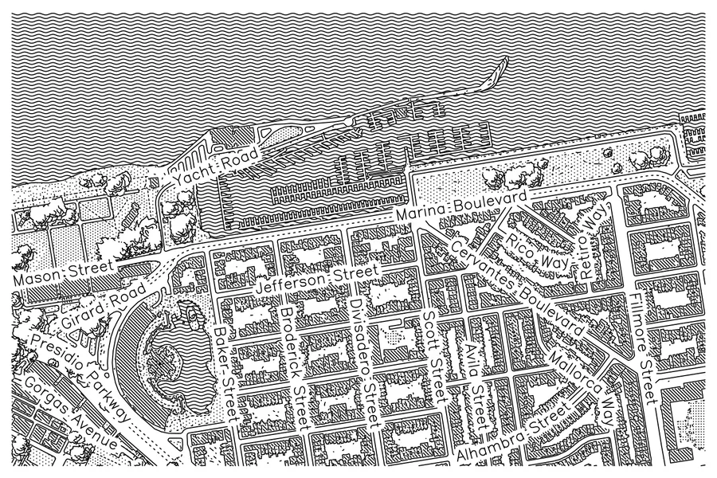

## Two ways to use it

| | |
|---|---|
| **Online, nothing to install** | [**draw.land**](https://draw.land): place a card on a map, pick one of the styles, edit its profile with autocomplete, download SVG, PNG, DXF or G-code, whole, per sheet or per pen. The [documentation](https://draw.land/docs) (gallery, tutorial, concepts, every pattern, the full reference) lives there too. |
| **From code** | This repository, open source (MIT): the same engine as a command line, and a library you call from **JavaScript or TypeScript**, **Python**, **Node** or **Rust**. Write the style as a profile script, or build it in your own language. |

```bash
cargo install drawland-cli      # the drawland command
pip install drawland            # Python 3.9+, the command included
npm install drawland            # Node 18+, the command included (npx drawland)
```

```bash
drawland map --address "Piazza Maggiore, Bologna" -o bologna.svg
```

## How it works

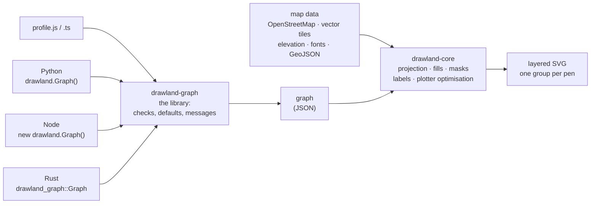

A style never touches geometry: it **describes** the map (which data, made
into which areas and lines, filled with which patterns, stacked and masked
how) and builds a graph of operations. The engine, in Rust, runs the graph on
the data, so the same style draws the same map everywhere.

The library a style calls (`features.tiles`, `areas.union`, `fills.fill`,
`compose.mask`…) is written once, in Rust (`drawland-graph`). JavaScript,
TypeScript, Python, Node and Rust are faces of that one library, equal: the
same functions, options, checks and error messages, and the same graph out.
A **profile** is a JavaScript or TypeScript file: the shareable form of a
style, the one draw.land's editor and gallery use.

| Piece | What it is | Where |
|---|---|---|
| `drawland-graph` | The library: every function a style calls, its checks, defaults and messages, building the graph. Called by name from JS and Python, with typed methods from Rust | [crates/drawland-graph](https://github.com/piLeoni/drawland/tree/main/crates/drawland-graph) |
| `drawland-core` | The engine: runs the graph. Projections (web Mercator, UTM, any PROJ string, your own), fills, masks, labels, sheets, plotter optimisation. No network, no files | [crates/drawland-core](https://github.com/piLeoni/drawland/tree/main/crates/drawland-core) |
| `drawland-script` | Profiles: a sandboxed JavaScript interpreter (Boa) running the library's JavaScript face; [`drawland.d.ts`](https://github.com/piLeoni/drawland/blob/main/crates/drawland-script/drawland.d.ts) describes it exactly | [crates/drawland-script](https://github.com/piLeoni/drawland/tree/main/crates/drawland-script) |
| `drawland-ts` | TypeScript profiles: the types taken out, every line and column kept | [crates/drawland-ts](https://github.com/piLeoni/drawland/tree/main/crates/drawland-ts) |
| `drawland` | All of the above plus everything a map reads: geocoding, Overpass, OpenFreeMap tiles, Terrarium elevation, fonts, datasets, cached on disk | [crates/drawland](https://github.com/piLeoni/drawland/tree/main/crates/drawland) |
| `drawland` command | `drawland map <profile>` | [crates/drawland-cli](https://github.com/piLeoni/drawland/tree/main/crates/drawland-cli) |
| Python package | `import drawland`: draw a profile, or build the graph in Python | [bindings/python](https://github.com/piLeoni/drawland/tree/main/bindings/python) |
| Node package | `require('drawland')`: the same, from Node, with TypeScript types | [bindings/node](https://github.com/piLeoni/drawland/tree/main/bindings/node) |
| [draw.land](https://draw.land) | The web page: the engine compiled to WebAssembly, with a map, an editor and the styles | its own repository |

The patterns come from [penfill](https://github.com/piLeoni/penfill), the
pen-and-ink terrain from [burin-map](https://github.com/piLeoni/burin-map),
the vector tiles as polygons from
[terramask](https://github.com/piLeoni/terramask), and stroke de-overlap
from [deoverlap](https://github.com/piLeoni/deoverlap): sibling libraries,
each with its own Python and Node packages.

## A profile

```js
title("Lake Merritt")
output({ lat: 37.802, lng: -122.263, width: "6in", height: "4in", scale: "1:8000" })

const bldg = features.tiles("buildings")
const buildings = areas.polygons(bldg)
const parks = areas.polygons(features.tiles("parks", "grass"))
const water = areas.polygons(features.tiles("water"))
const roads = modules.roads({ from: features.tiles("roads", "paths") })

draw({ id: "water", from: fills.fill({ in: water, pattern: "waves", spacing: "0.8mm" }) })
draw({ id: "shore", from: lines.rings(water) })
draw({ id: "parks", from: fills.fill({ in: parks, pattern: "dots", spacing: "0.6mm" }) })
draw({ id: "roads", from: roads.outlines })
draw({ id: "trails", from: roads.trails, stroke: { style: "dotted", mark: "0.1mm", gap: "0.5mm" } })
draw({ id: "roofs", from: fills.fill({ in: buildings, per: "feature", pattern: "lines", angle: 45, spacing: "0.6mm" }) })
draw({ id: "buildings", from: lines.rings(buildings) })

// The roads clear the dots and the waves under them; a building clears everything under it.
compose.mask({ from: roads.area, occludes: ["parks", "water"] })
compose.mask({ from: buildings, occludes: ["parks", "water", "roads", "trails"] })
// The water keeps the dots out, and a hair round it keeps them off the shore line.
compose.mask({ from: areas.grow(water, "0.3mm"), occludes: ["parks"] })
```

```bash
drawland map lake-merritt.js -o lake-merritt.svg
```

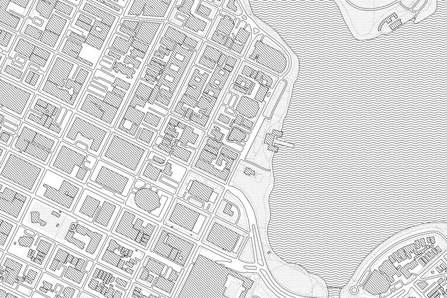

The script only builds a graph of operations; the engine runs it in Rust.
Every `id` is a group in the SVG, a pen of its own.

## Use

Full documentation for the command line, Python, Node and Rust:
**[draw.land/docs → For developers](https://draw.land/docs#developers)**.

### Command line

```bash
cargo install drawland-cli        # or: pip install drawland · npm install -g drawland
drawland map --address "Piazza Maggiore, Bologna" -o map.svg
drawland map city-grain.js --lat 37.8771 --lng -122.2562 -o berkeley.svg
```

With no profile it draws the postcard, an example built in
([crates/drawland/postcard.js](https://github.com/piLeoni/drawland/blob/main/crates/drawland/postcard.js)).

| Argument | Does |
|---|---|
| `profile` | A profile script (`.js`, `.ts`) or a saved graph (`.json`); default `postcard`, the example built in |
| `--address` / `--lat --lng` | Where; overrides the profile's `output({...})` |
| `--dump-graph` | Print the graph the profile builds, as JSON, and stop |
| `-o` | Output SVG (default `map.svg`) |
| `--per-layer` | Also one SVG per top-level layer (a file per pen) |
| `--slices` | For a card cut into sheets: `whole`, `slices` or `both` (default) |
| `--decimals` | Coordinate decimals in the SVG, 0 to 6 |
| `--cache` | Overpass / Nominatim response cache (default `cache/`; Overpass replies reused by any map they cover) |
| `--offline` | Use cached responses only |
| `--refresh` | Fetch again even when cached |

From a checkout: `./generate.sh "1730 Highland Pl, Berkeley, CA 94709"`
writes `exports/<address>/map.svg`.

A profile can be **TypeScript**: `drawland map style.ts` takes the types out
and runs it, with errors at the line and column you wrote.

### Python

```bash
pip install drawland
```

Draw a profile:

```python
import drawland

m = drawland.draw("city-grain.js", address="Piazza Maggiore, Bologna", progress=True)
print(m.groups)                       # [(group id, strokes), …]: a group is a pen
m.save("bologna.svg", per_layer=True)
```

or build the style in Python, with the same library:

```python
g = drawland.Graph()
g.output(lat=37.802, lng=-122.263, width="6in", height="4in", scale="1:8000")
water = g.areas.polygons(g.features.tiles("water"))
buildings = g.areas.polygons(g.features.tiles("buildings"))
g.draw(id="water", from_=g.fills.fill(in_=water, pattern="waves", spacing="0.8mm"))
g.draw(id="buildings", from_=g.lines.rings(buildings))
g.compose.mask(from_=buildings, occludes=["water"])
drawland.draw(g).save("lake.svg")
```

Options are keywords with the library's own names (`in_`, `from_` for `in`,
`from`); a `view` or a `remap` warp takes a Python function, and a GeoJSON
dataset can be any object with `__geo_interface__` (a GeoDataFrame).
[bindings/python](https://github.com/piLeoni/drawland/tree/main/bindings/python) · [docs](https://draw.land/docs#dev-python)

### Node

```bash
npm install drawland
```

```js
const drawland = require('drawland')

// A profile
const map = await drawland.draw({ profile: 'city-grain.js', lat: 37.8053, lng: -122.4436 })
map.save('marina.svg', { perLayer: true })

// or the graph built here: the library as a profile sees it, typed
const g = new drawland.Graph()
g.output({ lat: 37.802, lng: -122.263, width: '6in', height: '4in', scale: '1:8000' })
const water = g.areas.polygons(g.features.tiles('water'))
g.draw({ id: 'water', from: g.fills.fill({ in: water, pattern: 'waves', spacing: '0.8mm' }) })
;(await drawland.draw({ profile: g })).save('lake.svg')
```

[bindings/node](https://github.com/piLeoni/drawland/tree/main/bindings/node) · [docs](https://draw.land/docs#dev-node)

### Rust

```toml
[dependencies]
drawland = "0.3"         # draws: the library, the downloads, the engine
drawland-graph = "0.3"   # builds a graph, nothing else
```

```rust
use drawland::{Drawer, Place, Profile, Settings};
use drawland_graph::{obj, Graph};

let mut g = Graph::new(None);
g.output(obj! { "lat" => 37.802, "lng" => -122.263, "width" => "6in", "height" => "4in", "scale" => "1:8000" })?;
let w = g.features().tiles(&["water"])?;
let water = g.areas().polygons(&w)?;
let waves = g.fills().fill(obj! { "in" => &water, "pattern" => "waves", "spacing" => "0.8mm" })?;
g.draw(obj! { "id" => "water", "from" => &waves })?;

let map = Drawer::new(Settings::default()).draw(&Profile::graph(g.finish()?), &Place::default(), &())?;
map.save("lake.svg".as_ref(), Default::default())?;
```

A profile file draws the same way: `Profile::read("city-grain.js".as_ref())?`.
`drawland-core` alone draws a graph from bytes you fetched yourself, with no I/O.
[crates/drawland-graph](https://github.com/piLeoni/drawland/tree/main/crates/drawland-graph) · [docs](https://draw.land/docs#dev-rust)

## Gallery

Every picture below is an SVG written by `drawland map`. Each style is a
plain profile: open it on [draw.land](https://draw.land), save it from the
editor, and draw it here, anywhere.

<table>
<tr><td width="50%" valign="top"><br><b>City Grain</b><br>Every surface its own pattern, tree crowns as isoline stacks, the ground in burin hatching, names that clear what they cross.</td><td width="50%" valign="top">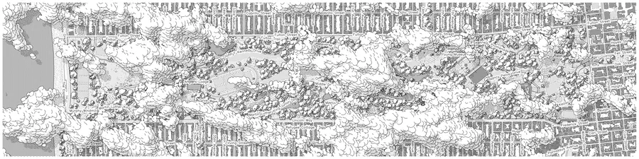<br><b>Karl the Fog</b><br>City Grain under cumulus: the clouds are a pattern, their footprint masks the city and, moved down-sun, is stippled as their shadow.</td></tr>
<tr><td width="50%" valign="top"><br><b>Napkin Sketch</b><br>Very little drawn, all of it loosened by a hand-drawn tremble at the end.</td><td width="50%" valign="top"><br><b>Béton Brut</b><br>A heavy nib: weight from offset passes side by side, never a wider pen.</td></tr>
<tr><td width="50%" valign="top"><br><b>Salt and Stone</b><br>Nothing built, all burin: contours, a concentric coast, currents that curl as the flow turns.</td><td width="50%" valign="top"><br><b>Tree Line</b><br>Contours as features with their heights as tags, coloured low to high, every fifth named along the line.</td></tr>
<tr><td width="50%" valign="top"><br><b>Lead Line</b><br>A sounding chart for any shore: depths read at points, dotted isobaths.</td><td width="50%" valign="top">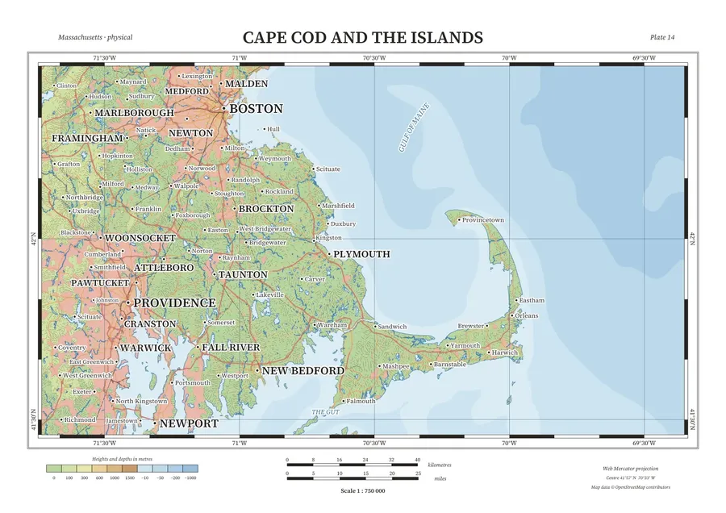<br><b>Schoolroom Atlas</b><br>A coloured physical map: hypsometric tints, depths, a graticule round an atlas plate.</td></tr>
<tr><td width="50%" valign="top">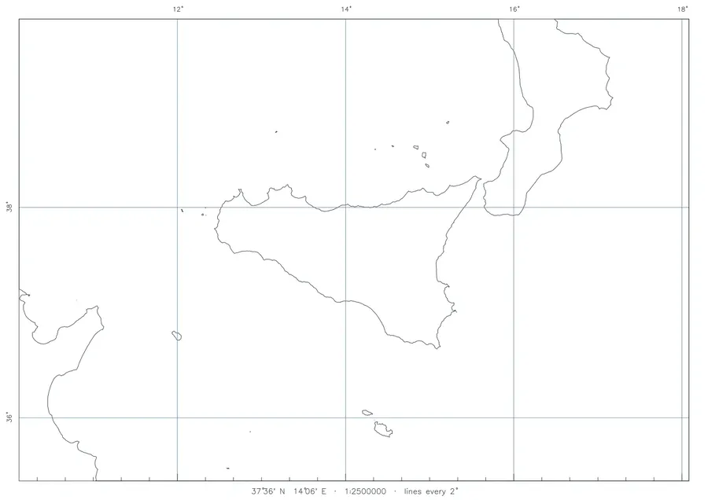<br><b>Dead Reckoning</b><br>A graticule worked out by the script, traced through the projection point by point.</td><td width="50%" valign="top">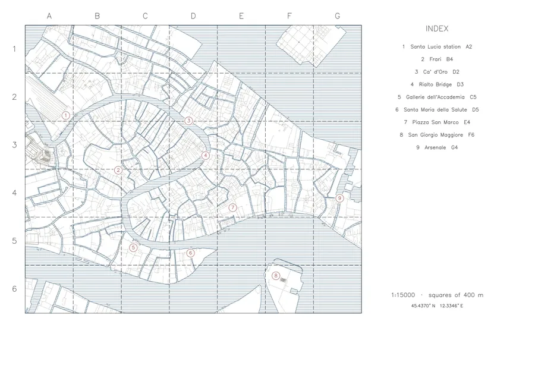<br><b>Square One</b><br>A city map's lettered grid, your places numbered on it, and an index: all arithmetic on the page.</td></tr>
<tr><td width="50%" valign="top"><br><b>Looking Glass</b><br>Japan in a projection written in the script (`warp: { remap }`): distance from the centre on a log scale.</td><td width="50%" valign="top">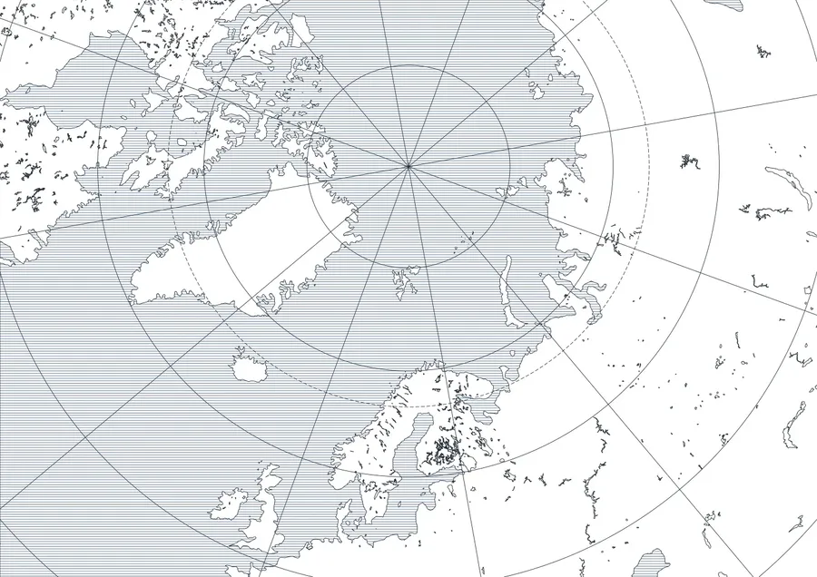<br><b>True North</b><br>The Arctic from above in polar stereographic, a PROJ string centred on the pole.</td></tr>
<tr><td width="50%" valign="top"><br><b>Shaky Ground</b><br>Live data: the last 30 days of quakes from the USGS feed, sized by magnitude, inked by depth.</td><td width="50%" valign="top">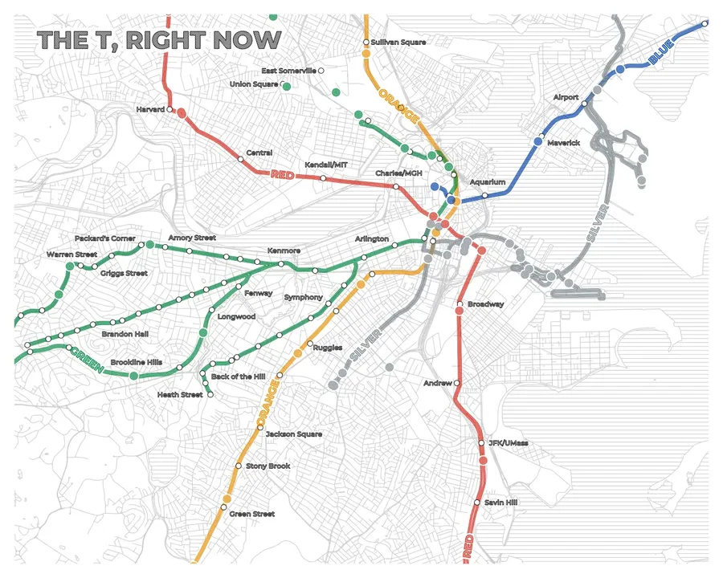<br><b>Rush Hour</b><br>Boston's T with every train where it is now, from GeoJSON lines and a plain-JSON API.</td></tr>
<tr><td width="50%" valign="top"><br><b>Red Pencil</b><br>A GeoJSON of your own over a quiet base map, for two pens that never touch.</td><td width="50%" valign="top">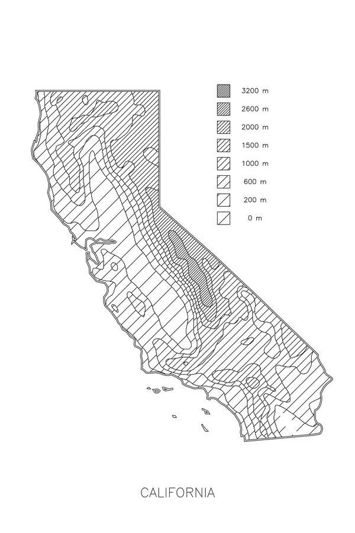<br><b>Cookie Cutter</b><br>A state's silhouette as a die-cut card, one hatch per height belt, the border on its own layer for the knife.</td></tr>
<tr><td width="50%" valign="top">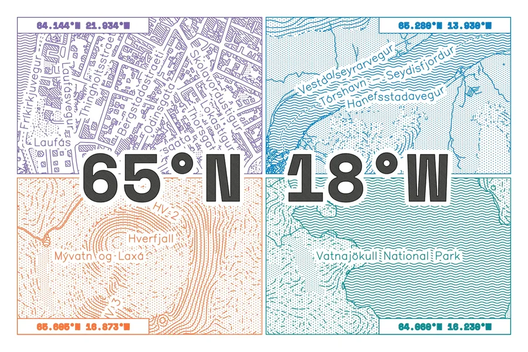<br><b>65°N 18°W</b><br>Four places in Iceland, each at its own scale, drawn as views into four corners of one card.</td></tr>
</table>

## What a profile can do

- **Map data**: vector tiles (OpenFreeMap), any Overpass query, GeoJSON and
  plain JSON from a file or a live URL, elevation and depth as contours,
  soundings or bands.
- **Patterns**: every [penfill](https://github.com/piLeoni/penfill) fill
  (hatches, dots, waves, isoline stacks, clouds, marble…) and
  [burin-map](https://github.com/piLeoni/burin-map) terrain in pen and ink.
- **Projections**: web Mercator, UTM, any PROJ string (a pole on the page),
  or one written in the script as a function of the page
  (`warp: { remap }`); fisheye, twirl and wave warps.
- **Composition**: masks that clear exactly the layers they name, offset
  double lines for weight, labels that knock out what they cross, views of
  other places drawn into a rectangle of the page.
- **The frame**: a script reads its page and the ground under it
  (`page`, `world`, `world.toPage`, `page.toWorld`) to lay out grids,
  graticules, indexes and titles.
- **For the machine**: merge, simplify, sort, de-overlap and a hand-drawn
  tremble; one SVG per pen; a card cut into sheets for a poster in tiles.

## Profiles

A profile is a JavaScript or TypeScript file that calls the draw.land library: where the
map is and on what paper (`output({...})`), which map data to read
(`features.tiles("buildings")`, `features.osm({ leisure: "park" })`), what to
make of it (`areas.*`, `lines.*`, `fills.fill`, `modules.roads()`), and how to
ink and stack it (`draw`, `compose`). The script only builds a graph; the
engine runs the graph in Rust. A script can ask about its frame as it runs —
`page` (the paper) and `world` (the ground under it: centre, scale, bounds,
`world.toPage({ lat, lng })`, `page.toWorld([x, y])`) — but never about the
data: heights and the like come back as features with tags
(`features.contours`, `features.soundings`).

A profile can draw another place into a rectangle of its page in a style
named by its script: `view({ id, at, size, lat, lng, scale }, "city-grain")`
reads `city-grain.js` (or `.ts`) beside the profile, from JavaScript, Python
or Node alike.

`crates/drawland-script/drawland.d.ts` is the library's exact description: an
editor that knows TypeScript autocompletes and type-checks a profile against
it (a `.ts` profile with `/// <reference path="drawland.d.ts" />`, or a `.js`
one with `// @ts-check`). The Node package carries the same types for
`Graph`.

## Repository layout

| Path | Role |
|---|---|
| `crates/drawland-graph` | The library: what a style calls, building the graph (`src/library.rs`) |
| `crates/drawland-core` | The graph's runner: projection, OSM and tiles → features, fills, compose, SVG. No I/O. |
| `crates/drawland-script` | Profile scripts: the JavaScript interpreter (Boa) and the library's JavaScript face (`src/library.js`) |
| `crates/drawland-ts` | TypeScript profiles, their types blanked out |
| `crates/drawland` | The library that draws a map: the script, the downloads and cache, the engine; the command line's code |
| `crates/drawland-cli` | The `drawland` binary |
| `bindings/python`, `bindings/node` | `pip install drawland`, `npm install drawland` |
| `configs/` | Example profiles |
| `docs/gallery/` | The README's pictures (drawn by the CLI from draw.land's styles) |
| `docs/architecture/` | Architecture index for contributors and coding agents (`AGENTS.md`) |
| `reference/python/` | The former Python pipeline, kept to read, not run |

## Contributing

```bash
cargo test
(cd bindings/node && npm install && npm run build && npm test)
(cd bindings/python && maturin develop && pytest)
```

The pattern types in `drawland.d.ts` are written from penfill's catalogue:
`cargo run -p drawland-script --example write_dts` (`cargo test` fails when
they are stale).

draw.land is developed against sibling checkouts of its own libraries:
penfill in `../penfill` (fills), terramask in `../terramask` (map tiles as
polygons, the sea, elevation bands), burin-map in `../burin-map` (pen-and-ink
terrain) and deoverlap in `../deoverlap`. Without them,
`python3 scripts/registry-deps.py` points the workspace at their published
versions on crates.io, which is what CI does. Start reading at
[AGENTS.md](https://github.com/piLeoni/drawland/blob/main/AGENTS.md) and
[docs/architecture/INDEX.md](https://github.com/piLeoni/drawland/blob/main/docs/architecture/INDEX.md).

## License

MIT. Use it, change it, ship it, in anything.
