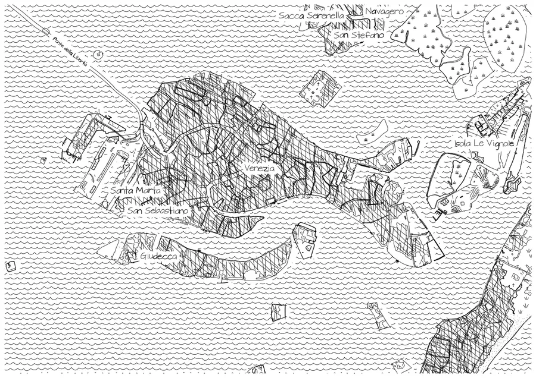
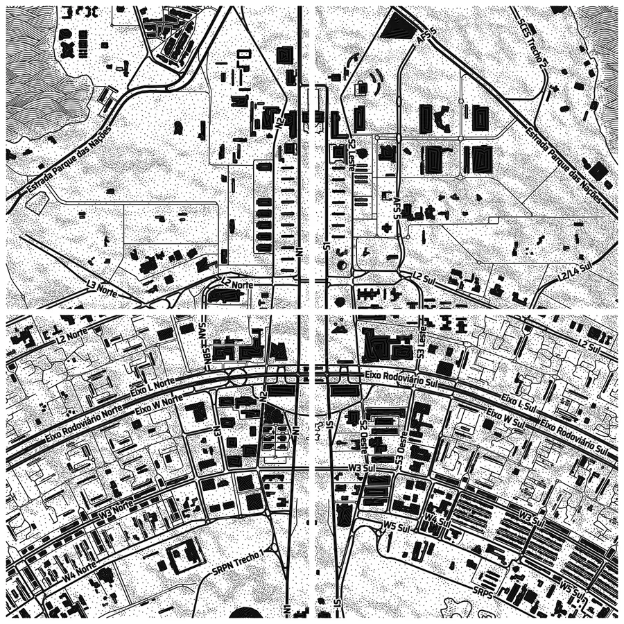
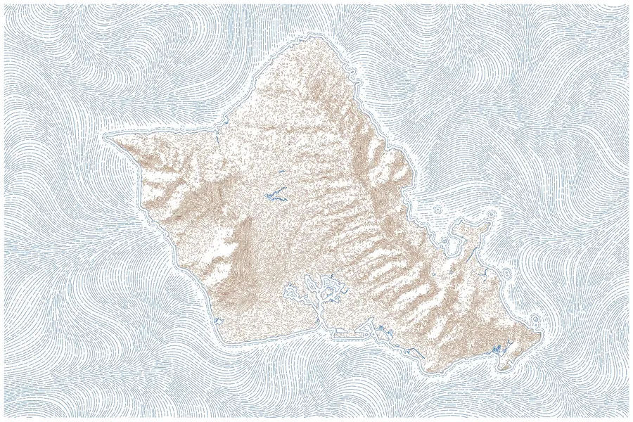
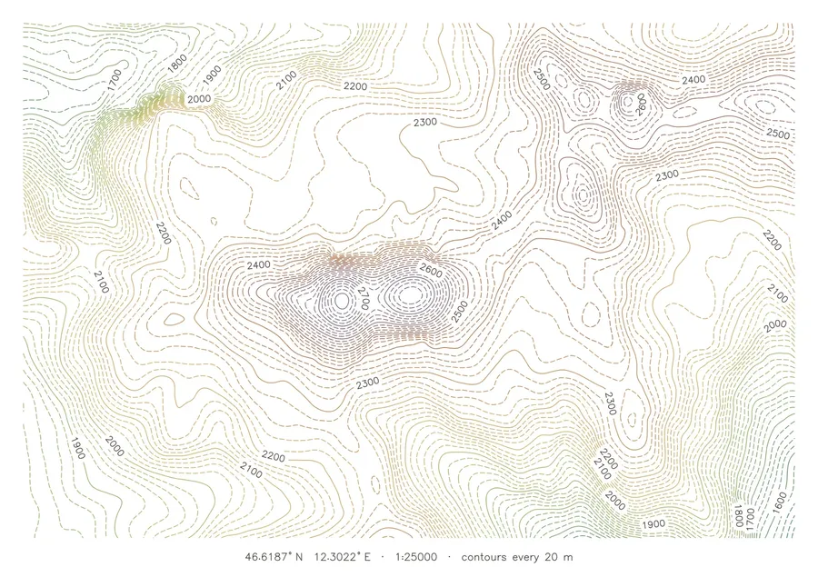
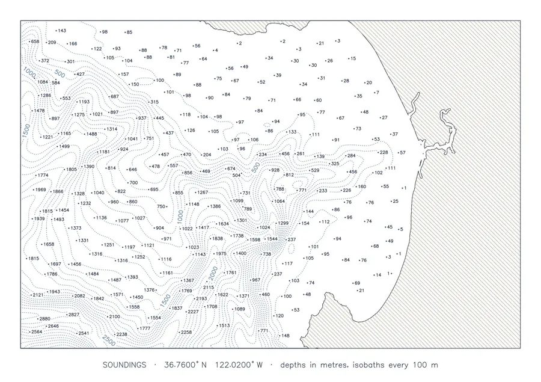
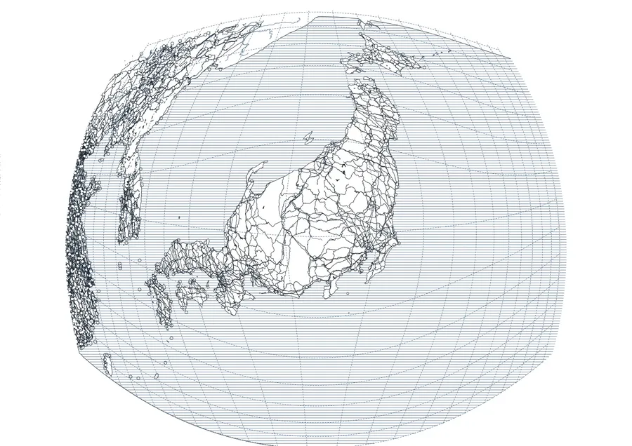
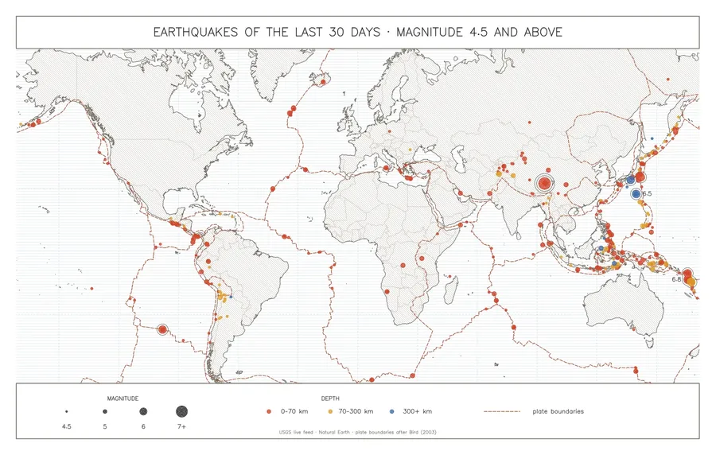
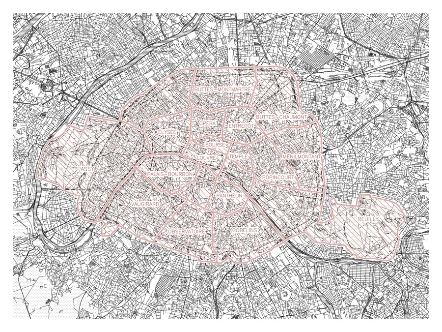

# draw.land

Turn any place on Earth into a pen-plotter map. OpenStreetMap data, vector
tiles and elevation are fetched, projected onto the paper and drawn as
distinct layers, one per pen: buildings hatched, parks dotted, water waved,
roads at their real width, contours, soundings, labels in single-stroke
fonts. The output is one layered SVG in paper millimetres. What is drawn, and
how, is a short JavaScript **profile**.


This repository is the engine and its command line, open source
(AGPL-3.0). The web page at [draw.land](https://draw.land) is built on it: a
map with a card to place, an editor, and the documentation at
[draw.land/docs](https://draw.land/docs) (tutorial, concepts, every pattern,
the full reference).

## A profile

```js
title("Lake Merritt")
output({ lat: 37.802, lng: -122.263, width: "6in", height: "4in", scale: "1:8000" })

const bldg = features.tiles("buildings")
const buildings = areas.polygons(bldg)
const parks = areas.polygons(features.tiles("parks", "grass"))
const water = areas.polygons(features.tiles("water"))
const roads = modules.roads({ from: features.tiles("roads", "paths") })

draw({ id: "water", from: fills.fill({ in: water, pattern: "waves", spacing: "0.8mm" }) })
draw({ id: "shore", from: lines.rings(water) })
draw({ id: "parks", from: fills.fill({ in: parks, pattern: "dots", spacing: "0.6mm" }) })
draw({ id: "roads", from: roads.outlines })
draw({ id: "trails", from: roads.trails, stroke: { style: "dotted", mark: "0.1mm", gap: "0.5mm" } })
draw({ id: "roofs", from: fills.fill({ in: buildings, per: "feature", pattern: "lines", angle: 45, spacing: "0.6mm" }) })
draw({ id: "buildings", from: lines.rings(buildings) })

// The roads clear the dots and the waves under them; a building clears everything under it.
compose.mask({ from: roads.area, occludes: ["parks", "water"] })
compose.mask({ from: buildings, occludes: ["parks", "water", "roads", "trails"] })
// The water keeps the dots out, and a hair round it keeps them off the shore line.
compose.mask({ from: areas.grow(water, "0.3mm"), occludes: ["parks"] })
```

```bash
drawland map lake-merritt.js -o lake-merritt.svg
```


The script only builds a graph of operations; the engine runs it in Rust.
Every `id` is a group in the SVG, a pen of its own.

## Gallery

Every picture below is an SVG written by `drawland map`. Each style is a
plain profile: open it on [draw.land](https://draw.land), save it from the
editor, and draw it here, anywhere.

<table>
<tr><td width="50%" valign="top"><br><b>City Grain</b><br>Every surface its own pattern, tree crowns as isoline stacks, the ground in burin hatching, names that clear what they cross.</td><td width="50%" valign="top"><br><b>Karl the Fog</b><br>City Grain under cumulus: the clouds are a pattern, their footprint masks the city and, moved down-sun, is stippled as their shadow.</td></tr>
<tr><td width="50%" valign="top"><br><b>Napkin Sketch</b><br>Very little drawn, all of it loosened by a hand-drawn tremble at the end.</td><td width="50%" valign="top"><br><b>Béton Brut</b><br>A heavy nib: weight from offset passes side by side, never a wider pen.</td></tr>
<tr><td width="50%" valign="top"><br><b>Salt and Stone</b><br>Nothing built, all burin: contours, a concentric coast, currents that curl as the flow turns.</td><td width="50%" valign="top"><br><b>Tree Line</b><br>Contours as features with their heights as tags, coloured low to high, every fifth named along the line.</td></tr>
<tr><td width="50%" valign="top"><br><b>Lead Line</b><br>A sounding chart for any shore: depths read at points, dotted isobaths.</td><td width="50%" valign="top"><br><b>Schoolroom Atlas</b><br>A coloured physical map: hypsometric tints, depths, a graticule round an atlas plate.</td></tr>
<tr><td width="50%" valign="top"><br><b>Dead Reckoning</b><br>A graticule worked out by the script, traced through the projection point by point.</td><td width="50%" valign="top"><br><b>Square One</b><br>A city map's lettered grid, your places numbered on it, and an index: all arithmetic on the page.</td></tr>
<tr><td width="50%" valign="top"><br><b>Looking Glass</b><br>Japan in a projection written in the script (`warp: { remap }`): distance from the centre on a log scale.</td><td width="50%" valign="top"><br><b>True North</b><br>The Arctic from above in polar stereographic, a PROJ string centred on the pole.</td></tr>
<tr><td width="50%" valign="top"><br><b>Shaky Ground</b><br>Live data: the last 30 days of quakes from the USGS feed, sized by magnitude, inked by depth.</td><td width="50%" valign="top"><br><b>Rush Hour</b><br>Boston's T with every train where it is now, from GeoJSON lines and a plain-JSON API.</td></tr>
<tr><td width="50%" valign="top"><br><b>Red Pencil</b><br>A GeoJSON of your own over a quiet base map, for two pens that never touch.</td><td width="50%" valign="top"><br><b>Cookie Cutter</b><br>A state's silhouette as a die-cut card, one hatch per height belt, the border on its own layer for the knife.</td></tr>
<tr><td width="50%" valign="top"><br><b>65°N 18°W</b><br>Four places in Iceland, each at its own scale, drawn as views into four corners of one card.</td></tr>
</table>

## What a profile can do

- **Map data**: vector tiles (OpenFreeMap), any Overpass query, GeoJSON and
  plain JSON from a file or a live URL, elevation and depth as contours,
  soundings or bands.
- **Patterns**: every [penfill](https://github.com/piLeoni/penfill) fill
  (hatches, dots, waves, isoline stacks, clouds, marble…) and
  [burin-map](https://github.com/piLeoni/burin-map) terrain in pen and ink.
- **Projections**: web Mercator, UTM, any PROJ string (a pole on the page),
  or one written in the script as a function of the page
  (`warp: { remap }`); fisheye, twirl and wave warps.
- **Composition**: masks that clear exactly the layers they name, offset
  double lines for weight, labels that knock out what they cross, views of
  other places drawn into a rectangle of the page.
- **The frame**: a script reads its page and the ground under it
  (`page`, `world`, `world.toPage`, `page.toWorld`) to lay out grids,
  graticules, indexes and titles.
- **For the machine**: merge, simplify, sort, de-overlap and a hand-drawn
  tremble; one SVG per pen; a card cut into sheets for a poster in tiles.

## Use

The command line installs from crates.io:

```bash
cargo install drawland-cli
drawland map --address "Piazza Maggiore, Bologna" -o map.svg
```

With no profile it draws the postcard, an example built in
([crates/drawland-cli/postcard.js](crates/drawland-cli/postcard.js)). From a
checkout:

```bash
./generate.sh "1730 Highland Pl, Berkeley, CA 94709"
# → exports/1730_highland_pl_berkeley_ca_94709/map.svg
```

or directly:

```bash
cargo run --release -p drawland-cli -- map --address "Piazza Maggiore, Bologna" -o map.svg
cargo run --release -p drawland-cli -- map configs/contours.js --lat 46.5 --lng 11.85
```

| Argument | Does |
|---|---|
| `profile` | A profile script (`.js`) or a saved graph (`.json`); default `postcard`, the example built in |
| `--address` / `--lat --lng` | Where; overrides the profile's `output({...})` |
| `--dump-graph` | Print the graph the profile builds, as JSON, and stop |
| `-o` | Output SVG (default `map.svg`) |
| `--cache` | Overpass / Nominatim response cache (default `cache/`; Overpass replies in `cache/overpass/`, reused by any map they cover) |
| `--offline` | Use cached responses only |
| `--refresh` | Fetch datasets again even when cached |
| `--slices` | For a card cut into sheets: `whole`, `slices` or `both` (default) |
| `--per-layer` | Also one SVG per top-level layer (a file per pen) |

## Profiles

A profile is a JavaScript file that calls the draw.land library: where the
map is and on what paper (`output({...})`), which map data to read
(`features.tiles("buildings")`, `features.osm({ leisure: "park" })`), what to
make of it (`areas.*`, `lines.*`, `fills.fill`, `modules.roads()`), and how to
ink and stack it (`draw`, `compose`). The script only builds a graph; the
engine runs the graph in Rust. A script can ask about its frame as it runs —
`page` (the paper) and `world` (the ground under it: centre, scale, bounds,
`world.toPage({ lat, lng })`, `page.toWorld([x, y])`) — but never about the
data: heights and the like come back as features with tags
(`features.contours`, `features.soundings`).

A profile can draw another place into a rectangle of its page in a style
named by its script: `view({ id, at, size, lat, lng, scale }, "city-grain")`
reads `city-grain.js` beside the profile.

`crates/drawland-script/drawland.d.ts` is the library's exact description: an
editor that knows TypeScript autocompletes and type-checks a profile against
it (`// @ts-check` with the file in a `jsconfig.json`).

## Layout

| Path | Role |
|---|---|
| `crates/drawland-core` | The graph and its runner, projection, OSM and tiles → features, fills, compose, SVG. No I/O. |
| `crates/drawland-script` | Profile scripts: the library and its JavaScript engine (Boa), script → graph |
| `crates/drawland-cli` | The `drawland` binary: geocoding, Overpass, vector tiles, cache |
| `configs/` | Example profiles |
| `docs/gallery/` | The README's pictures (drawn by the CLI from draw.land's styles) |
| `docs/architecture/` | Architecture index for contributors and coding agents (`AGENTS.md`) |
| `reference/python/` | The former Python pipeline, kept to read, not run |

## Tests

```bash
cargo test
```

The pattern types in `drawland.d.ts` are written from penfill's catalogue:
`cargo run -p drawland-script --example write_dts` (`cargo test` fails when
they are stale).

draw.land builds against sibling checkouts of its own libraries, developed
alongside it: penfill in `../penfill` (fills), terramask in `../terramask`
(map tiles as polygons, the sea, elevation bands), burin-map in
`../burin-map` (pen-and-ink terrain) and deoverlap in `../deoverlap`.

## License

AGPL-3.0-only.
