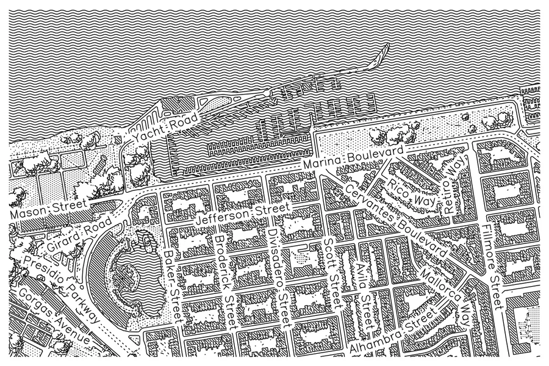

# drawland for Node

OpenStreetMap drawn as layered pen-plotter SVGs. A style says what is drawn
and how: buildings hatched, parks stippled, water in waves, roads at their
real width, contours, names in single-stroke fonts. `drawland` runs it at a
place, downloads what it reads (vector tiles, Overpass, elevation, fonts,
datasets; cached on disk) and returns one SVG in paper millimetres, a group
per pen.



```sh
npm install drawland
```

## Draw a profile

A profile is a JavaScript or TypeScript file: every style in the gallery at
[draw.land](https://draw.land) is one, saved from its editor.

```js
import drawland from 'drawland'

const map = await drawland.draw({ profile: 'city-grain.js', lat: 37.8053, lng: -122.4436, progress: true })
console.log(map.title, map.groups)        // [{ id, strokes }]: a group is a pen
map.save('marina.svg', { perLayer: true }) // marina.svg, marina-roads.svg, …
```

## Or build the style in Node

The library a profile calls, as an object, typed (the package ships the
TypeScript types of every function):

```ts
import drawland from 'drawland'

const g = new drawland.Graph()
g.output({ lat: 37.802, lng: -122.263, width: '6in', height: '4in', scale: '1:8000' })
const water = g.areas.polygons(g.features.tiles('water'))
const buildings = g.areas.polygons(g.features.tiles('buildings'))
g.draw({ id: 'water', from: g.fills.fill({ in: water, pattern: 'waves', spacing: '0.8mm' }) })
g.draw({ id: 'buildings', from: g.lines.rings(buildings) })
g.compose.mask({ from: buildings, occludes: ['water'] })

;(await drawland.draw({ profile: g })).save('lake.svg')
```

`g.view(spec, () => { … })` and a `remap` warp take Node functions; a view
can name a JavaScript style beside `new Graph({ dir })`.

## Reference

| | |
|---|---|
| `draw({ profile, script, typescript, dir, lat, lng, address, cache, offline, refresh, progress })` | Draw a file (`.js`, `.ts`, `.json`), a `Graph`, a script's text, or the postcard, off the main thread: a `Promise<Map>` |
| `graph({ … })` | The graph a profile builds, as an object; nothing downloaded |
| `new Graph({ lat, lng, dir })` | A graph built in Node; `.finish()` for the graph |
| `map.svg`, `.title`, `.groups`, `.slices` | The whole SVG; the title; `{ id, strokes }` per pen; `{ suffix, svg }` per sheet |
| `map.save(path, { perLayer, slices, decimals })` / `map.files({ … })` | Write the files (their paths) / the same, unwritten |
| `POSTCARD`, `FUNCTIONS`, `cli(argv)` | The built-in profile; every function of the library; the command line |

The package has the command line too: `npx drawland map city-grain.js --lat 37.8053 --lng -122.4436`.
Prebuilt for macOS (arm64, x64), Linux (x64, arm64, glibc) and Windows (x64).
How to write a style, every pattern and the full reference:
[draw.land/docs](https://draw.land/docs). Source:
[github.com/piLeoni/drawland](https://github.com/piLeoni/drawland). MIT.
