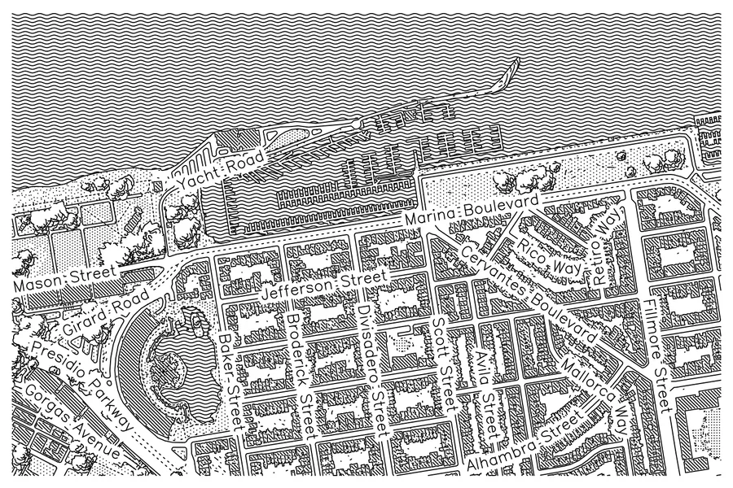

# drawland for Python

OpenStreetMap drawn as layered pen-plotter SVGs. A style says what is drawn
and how: buildings hatched, parks stippled, water in waves, roads at their
real width, contours, names in single-stroke fonts. `drawland` runs it at a
place, downloads what it reads (vector tiles, Overpass, elevation, fonts,
datasets; cached on disk) and returns one SVG in paper millimetres, a group
per pen.



```sh
pip install drawland
```

## Draw a profile

A profile is a JavaScript or TypeScript file: every style in the gallery at
[draw.land](https://draw.land) is one, saved from its editor.

```python
import drawland

m = drawland.draw(lat=37.8771, lng=-122.2562)            # the built-in postcard
m = drawland.draw("city-grain.js", address="Piazza Maggiore, Bologna", progress=True)
print(m.title, m.groups)                                   # [(group, strokes)]: a group is a pen
m.save("bologna.svg", per_layer=True)                      # bologna.svg, bologna-roads.svg, …
```

## Or build the style in Python

The same library a profile calls, with the same names, checks and errors:

```python
g = drawland.Graph()
g.output(lat=37.802, lng=-122.263, width="6in", height="4in", scale="1:8000")
water = g.areas.polygons(g.features.tiles("water"))
buildings = g.areas.polygons(g.features.tiles("buildings"))
roads = g.modules.roads(from_=g.features.tiles("roads", "paths"))

g.draw(id="water", from_=g.fills.fill(in_=water, pattern="waves", spacing="0.8mm"))
g.draw(id="roads", from_=roads["outlines"])
g.draw(id="buildings", from_=g.lines.rings(buildings, exteriorOnly=True))
g.compose.mask(from_=roads["area"], occludes=["water"])

drawland.draw(g).save("lake.svg")
```

- Positional arguments as in the reference; options as keywords, with the
  library's names (`exteriorOnly`, `minLength`); `in_` and `from_` are
  `in` and `from`. Snake case works for function names (`fill_holes`).
- The frame while you build: `g.page.width`, `g.world.center`,
  `g.world.zoom`, `g.world.toPage({"lat": …, "lng": …})`, `g.page.toWorld([x, y])`.
- Ranges by zoom or scale, as a Mapbox style writes them: a list such as
  `["step", ["zoom"], 1, 15, 3]` anywhere in a call's options is worked out
  for the map's zoom; `g.world.at([...])` gives its value.
- Your data: `g.features.geojson(gdf)` takes a GeoDataFrame or anything with
  `__geo_interface__`; numpy values are fine anywhere a number is.
- Functions: `g.view(draw_inset, id="inset", at=[110, 8], size=[36, 24], lat=…, lng=…, scale="1:40000")`
  calls `draw_inset(g)` to draw another place in a rectangle; `"city-grain"`
  instead of a function draws it in a JavaScript style beside `Graph(dir=…)`.
  `g.output(warp={"remap": f, "grid": 64})` is a projection of your own:
  `f([x, y])` returns where a page point goes.

## Reference

| | |
|---|---|
| `draw(profile=None, *, script, typescript, dir, lat, lng, address, cache="cache", offline, refresh, progress)` | Draw a file (`.js`, `.ts`, `.json`), a `Graph`, a script's text, or the postcard; a `Map` |
| `graph(profile=None, *, …)` | The graph a profile builds, as a dict; nothing downloaded |
| `Graph(*, lat, lng, dir)` | A graph built in Python; `.to_dict()` for the graph |
| `Map.svg`, `.title`, `.groups`, `.slices` | The whole SVG; the title; `(id, strokes)` per pen; `{name: svg}` per sheet |
| `Map.save(path, *, per_layer, slices, decimals)` / `Map.files(…)` | Write the files (their paths) / the same as `{suffix: svg}` |
| `Error` | Raised for a mistake in a style, a failed download, no place |
| `POSTCARD`, `FUNCTIONS`, `cli(argv)` | The built-in profile; every function of the library; the command line |

The package installs the `drawland` command too. `draw` releases the GIL.
How to write a style, every pattern and the full reference:
[draw.land/docs](https://draw.land/docs). Source:
[github.com/piLeoni/drawland](https://github.com/piLeoni/drawland). MIT.
