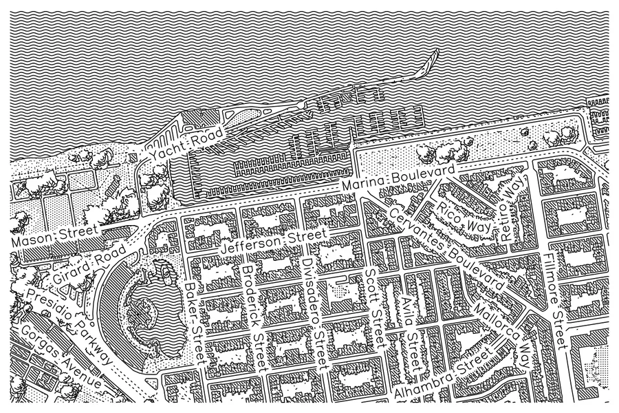

# drawland-graph

The draw.land library, in Rust: every function a map style calls
(`features.tiles`, `areas.union`, `fills.fill`, `modules.roads`,
`compose.mask`…), its checks, defaults and error messages, building the
graph of operations [draw.land](https://draw.land)'s engine draws as a
layered pen-plotter SVG.



It is the one implementation behind every face of draw.land: JavaScript and
TypeScript profiles (`drawland-script`), `import drawland` in Python,
`require('drawland')` in Node, and this crate's typed API for Rust. The same
calls give the same graph in each.

```rust
use drawland_graph::{obj, Graph};

let mut g = Graph::new(None);
g.output(obj! { "lat" => 37.802, "lng" => -122.263, "width" => "6in", "height" => "4in", "scale" => "1:8000" })?;
let b = g.features().tiles(&["buildings"])?;
let buildings = g.areas().polygons(&b)?;
let roofs = g.fills().fill(obj! { "in" => &buildings, "pattern" => "lines", "angle" => 45, "spacing" => "0.6mm" })?;
g.draw(obj! { "id" => "roofs", "from" => &roofs })?;
let rings = g.lines().rings(&buildings, obj! {})?;
g.draw(obj! { "id" => "buildings", "from" => &rings })?;
let graph = g.finish()?; // what drawland-core draws
# Ok::<(), drawland_graph::Error>(())
```

- Handles are typed: `Features`, `Area`, `Lines`; options are objects
  (`obj!`) with the keys of the reference at
  [draw.land/docs](https://draw.land/docs).
- `g.view(spec, |g| …)` draws another place into a rectangle of the page;
  `g.output_remap(spec, &mut [&mut f])` takes a projection of your own as a
  Rust function of page points.
- `g.page()` and `g.world()` answer about the frame while you build:
  `world().to_page(lat, lng)`, `page().to_world([x, y])`.
- `Graph::call(name, args)` is the library by name, as the other languages
  call it.

To draw the graph with the downloads included, use the
[`drawland`](https://crates.io/crates/drawland) crate:
`Drawer::draw(&Profile::graph(graph), …)`.

Source and docs: [github.com/piLeoni/drawland](https://github.com/piLeoni/drawland).
MIT.
