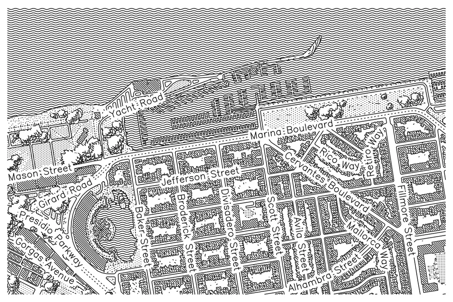

# drawland

OpenStreetMap drawn as layered pen-plotter SVGs, as a Rust library: a
JavaScript **profile** and a place in, the SVG out, with what the map reads
downloaded and cached (vector tiles, Overpass, Terrarium elevation, fonts,
datasets). The `drawland` command line (`cargo install drawland-cli`) and
the Python and Node packages are this crate.



```toml
[dependencies]
drawland = "0.3"
```

```rust,no_run
use drawland::{Drawer, ExportOptions, Place, Profile, Settings};

let drawer = Drawer::new(Settings::default());              // cache in ./cache
let profile = Profile::read("city-grain.js".as_ref())?;      // .js, .ts, .json; or Profile::postcard(), Profile::graph(g)
let map = drawer.draw(&profile, &Place::at(37.8771, -122.2562), &())?;
for (group, strokes) in &map.groups {
    println!("{group}: {strokes} strokes");
}
map.save("map.svg".as_ref(), ExportOptions::default())?;
# Ok::<(), String>(())
```

- `Drawer::draw` / `draw_graph` draw; `Drawer::graph` only runs the script.
- Progress goes to any `drawland_core::progress::Progress`: `&()` for none,
  `drawland::Term` paints it in a terminal.
- `drawland::cli::run(args)` is the whole command line.
- A style built in Rust instead of a script: `drawland-graph`'s `Graph`, then
  `Profile::graph(g.finish()?)`.
- Without the downloads: `drawland-graph` (calls → graph), `drawland-script`
  (a JavaScript or TypeScript profile → graph) and `drawland-core` (graph +
  the bytes you fetched → SVG, no I/O).

Docs: [draw.land/docs](https://draw.land/docs#dev-rust). Source:
[github.com/piLeoni/drawland](https://github.com/piLeoni/drawland).
MIT.
